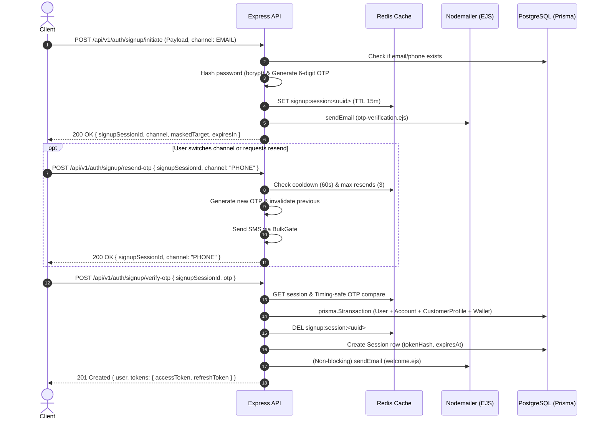
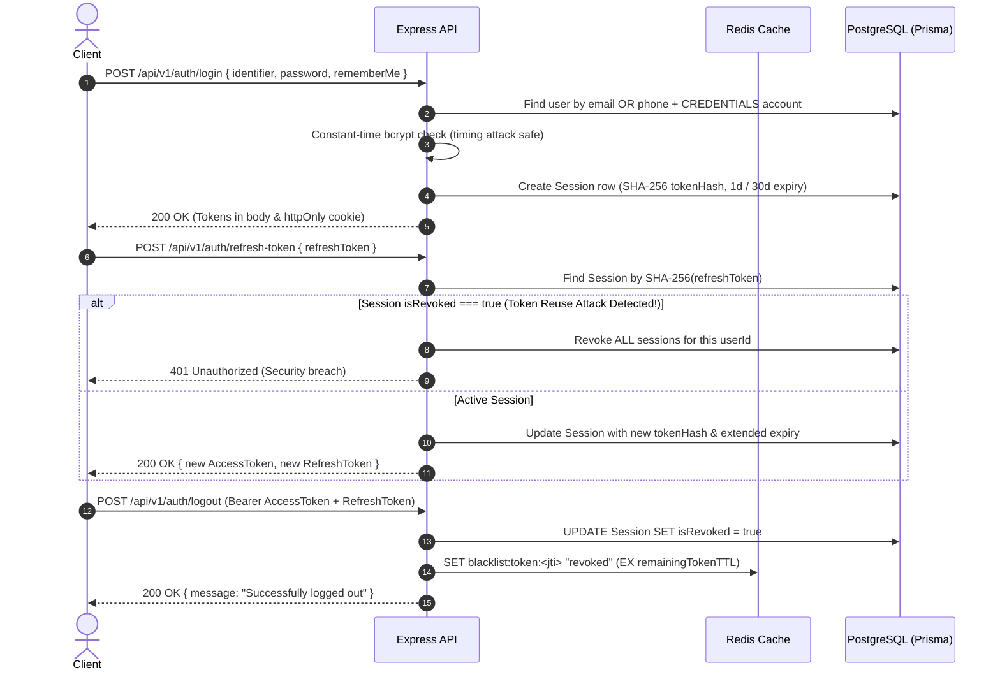

# Deligo Authentication & Email Service Documentation

This document describes the architecture, database models, security mechanisms, API routes, email templates, and testing procedures for the **Authentication**, **Session Management**, and **Nodemailer + EJS Email Service** in the Deligo Ride-Sharing Backend.

---

## 1. Architecture & Security Overview

### Key Highlights
- **Locked Prisma Schema Compliance**: Strictly adheres to existing `User`, `Account`, `Session`, `CustomerProfile`, and `Wallet` models.
- **Two-Step Registration with OTP**: Pending registrations reside in Redis (`signup:session:<id>`) with a 15-minute TTL until verified. Only upon successful OTP verification is the user committed to PostgreSQL atomically.
- **Dynamic Channel Switching**: Users can switch between `EMAIL` and `PHONE` verification on the fly, with rate-limiting cooldowns (60s) and max resend limits (3 attempts).
- **Atomic Database Writes**: `prisma.$transaction` guarantees that `User`, `Account` (provider `CREDENTIALS`), `CustomerProfile`, and `Wallet` (USD 0.00) are created together or rolled back. Unique referral codes (`DLXXXXXX`) are generated automatically.
- **Multi-Device Session Management**: Each login or signup issues a cryptographically signed Access Token (15m) and Refresh Token (1d default, 30d if `rememberMe`). Refresh token hashes (`SHA-256`) are persisted in the PostgreSQL `Session` table.
- **Token Rotation & Breach Detection**: Every refresh rotates the refresh token. If a previously rotated (or revoked) token is presented, the system detects a token reuse attack and revokes **all** active sessions for that user.
- **Instant Logout via Blacklisting**: Logout revokes the session in PostgreSQL and immediately blacklists the Access Token's `jti` in Redis for its remaining lifespan. The `authenticate` middleware rejects blacklisted tokens.
- **Timing Attack Prevention**: Login uses a dummy `bcrypt` comparison when an identifier is not found, mitigating timing-based user enumeration.
- **Production-Grade Nodemailer & EJS**: Employs connection pooling (`pool: true`), a responsive `layout.ejs` wrapper, multi-language support (`EN` / `PT`), and structured error handling that avoids unhandled promise crashes.

---

## 2. Mermaid Sequence Diagrams

### A. Signup & OTP Verification Flow



### B. Login, Token Refresh & Logout Flow



---

## 3. Environment Variables Reference

Add the following to your `.env` file (see `.env.example`):

```bash
# JWT Configuration
JWT_ACCESS_SECRET="your_super_secret_jwt_access_key_here_at_least_32_characters"
JWT_ACCESS_EXPIRES_IN="15m"
JWT_REFRESH_SECRET="your_super_secret_refresh_key_here_at_least_32_characters"
JWT_REFRESH_EXPIRES_IN_DEFAULT="1d"
JWT_REFRESH_EXPIRES_IN_REMEMBER="30d"

# OTP & Registration Session Configuration
OTP_EXPIRES_IN_SECONDS=300
SIGNUP_SESSION_TTL_SECONDS=900

# SMTP / Nodemailer Email Service
SMTP_HOST="smtp.gmail.com"
SMTP_PORT=587
SMTP_SECURE=false
SMTP_USER="your_email@gmail.com"
SMTP_PASS="your_app_password"
EMAIL_FROM_NAME="Deligo Ride"
EMAIL_FROM_ADDRESS="noreply@deligo.com"
```

---

## 4. API Endpoints Reference

Base path: `/api/v1/auth`

### 1. Initiate Signup
- **Method**: `POST`
- **Path**: `/api/v1/auth/signup/initiate`
- **Auth**: Public
- **Request Body**:
```json
{
  "firstName": "John",
  "lastName": "Doe",
  "email": "john.doe@example.com",
  "phone": "+15551234567",
  "password": "Password123!",
  "preferredLanguage": "EN",
  "referralCode": "DLABC123",
  "otpChannel": "EMAIL"
}
```
*Note: At least one of `email` or `phone` is required. `otpChannel` can be `EMAIL` or `PHONE`.*

- **Response (200 OK)**:
```json
{
  "success": true,
  "data": {
    "signupSessionId": "27b42eec-5bf1-437e-8283-0eed44874e40",
    "channel": "EMAIL",
    "maskedTarget": "j***e@example.com",
    "expiresIn": 300
  }
}
```

---

### 2. Resend OTP (with Channel Switching)
- **Method**: `POST`
- **Path**: `/api/v1/auth/signup/resend-otp`
- **Auth**: Public
- **Request Body**:
```json
{
  "signupSessionId": "27b42eec-5bf1-437e-8283-0eed44874e40",
  "channel": "PHONE"
}
```
*Note: Omitting `channel` resends on the current channel. Enforces a 60-second cooldown and a maximum of 3 resends per session.*

- **Response (200 OK)**:
```json
{
  "success": true,
  "data": {
    "signupSessionId": "27b42eec-5bf1-437e-8283-0eed44874e40",
    "channel": "PHONE",
    "maskedTarget": "+15***67",
    "expiresIn": 300
  }
}
```

---

### 3. Verify OTP & Complete Signup
- **Method**: `POST`
- **Path**: `/api/v1/auth/signup/verify-otp`
- **Auth**: Public
- **Request Body**:
```json
{
  "signupSessionId": "27b42eec-5bf1-437e-8283-0eed44874e40",
  "otp": "123456"
}
```

- **Response (201 Created)**:
```json
{
  "success": true,
  "data": {
    "user": {
      "id": "3665278e-5acf-41e9-939d-1d9f81514a5b",
      "email": "john.doe@example.com",
      "phone": "+15551234567",
      "firstName": "John",
      "lastName": "Doe",
      "role": "CUSTOMER",
      "status": "ACTIVE",
      "profilePicture": null,
      "preferredLanguage": "EN",
      "referralCode": "DLFKCZ3G",
      "isEmailVerified": true,
      "isPhoneVerified": false,
      "createdAt": "2026-11-17T09:00:00.000Z"
    },
    "tokens": {
      "accessToken": "eyJhbGciOiJIUzI1NiIsIn...",
      "refreshToken": "eyJhbGciOiJIUzI1NiIsIn...",
      "expiresIn": 900
    }
  }
}
```
*(Also sets `refreshToken` in `httpOnly` secure cookie).*

---

### 4. Login (Email or Phone)
- **Method**: `POST`
- **Path**: `/api/v1/auth/login`
- **Auth**: Public
- **Request Body**:
```json
{
  "identifier": "john.doe@example.com",
  "password": "Password123!",
  "rememberMe": true
}
```
*Note: `identifier` accepts either the user's registered email or phone number.*

- **Response (200 OK)**:
```json
{
  "success": true,
  "data": {
    "user": { ... },
    "tokens": {
      "accessToken": "eyJhbGciOiJIUzI1NiIsIn...",
      "refreshToken": "eyJhbGciOiJIUzI1NiIsIn...",
      "expiresIn": 900
    }
  }
}
```

---

### 5. Rotate Refresh Token
- **Method**: `POST`
- **Path**: `/api/v1/auth/refresh-token`
- **Auth**: Public (Requires refresh token in cookie or body)
- **Request Body** (optional if cookie is sent):
```json
{
  "refreshToken": "eyJhbGciOiJIUzI1NiIsIn..."
}
```

- **Response (200 OK)**:
```json
{
  "success": true,
  "data": {
    "tokens": {
      "accessToken": "eyJhbGciOiJIUzI1NiIsIn...",
      "refreshToken": "eyJhbGciOiJIUzI1NiIsIn...",
      "expiresIn": 900
    }
  }
}
```

---

### 6. Logout
- **Method**: `POST`
- **Path**: `/api/v1/auth/logout`
- **Headers**: `Authorization: Bearer <accessToken>`
- **Request Body** (optional): `{ "refreshToken": "..." }`
- **Response (200 OK)**:
```json
{
  "success": true,
  "data": {
    "message": "Successfully logged out"
  }
}
```

---

## 5. Email Service Details (`src/utils/email.service.ts`)

### Features
1. **Singleton Transporter**: Built with `pool: true` to reuse connections and avoid per-message TLS handshake overhead.
2. **Safe Fallback**: In environments where SMTP credentials are not yet configured (e.g. fresh local development), emails log rich previews to the console without crashing or throwing.
3. **Template Engine**:
   - `src/templates/emails/layout.ejs`: Base HTML container with Deligo branding and mobile-responsive styles.
   - `src/templates/emails/otp-verification.ejs`: High-contrast verification code card, expiry indicator, anti-phishing warnings, and full bilingual support (`EN` / `PT`).
   - `src/templates/emails/welcome.ejs`: Onboarding email featuring the user's unique referral code and call-to-action button.

### Usage Example
```typescript
import { sendEmail } from '../utils/email.service';

await sendEmail({
  to: 'user@example.com',
  subject: 'Verify Your Deligo Account',
  template: 'otp-verification',
  data: {
    name: 'Alex',
    otpCode: '482910',
    expiryMinutes: 5,
    preferredLanguage: 'EN', // or 'PT'
  },
});
```

---

## 6. Testing Guide

### Automated End-to-End Test Suite
An automated integration test script covers all 11 core verification scenarios:
```bash
# Run the complete test suite
npx ts-node scripts/test-auth-e2e.ts
```

### Manual cURL Commands

#### 1. Initiate Signup
```bash
curl -X POST http://localhost:3000/api/v1/auth/signup/initiate \
  -H "Content-Type: application/json" \
  -d '{
    "firstName": "Maria",
    "lastName": "Santos",
    "email": "maria.santos@example.com",
    "phone": "+5511999998888",
    "password": "Password123!",
    "preferredLanguage": "PT",
    "otpChannel": "EMAIL"
  }'
```

#### 2. Switch Channel to SMS
```bash
curl -X POST http://localhost:3000/api/v1/auth/signup/resend-otp \
  -H "Content-Type: application/json" \
  -d '{
    "signupSessionId": "<SIGNUP_SESSION_ID>",
    "channel": "PHONE"
  }'
```

#### 3. Verify OTP
```bash
curl -X POST http://localhost:3000/api/v1/auth/signup/verify-otp \
  -H "Content-Type: application/json" \
  -d '{
    "signupSessionId": "<SIGNUP_SESSION_ID>",
    "otp": "<6_DIGIT_OTP>"
  }'
```

#### 4. Login with Email
```bash
curl -X POST http://localhost:3000/api/v1/auth/login \
  -H "Content-Type: application/json" \
  -d '{
    "identifier": "maria.santos@example.com",
    "password": "Password123!",
    "rememberMe": true
  }'
```

#### 5. Refresh Token
```bash
curl -X POST http://localhost:3000/api/v1/auth/refresh-token \
  -H "Content-Type: application/json" \
  -d '{
    "refreshToken": "<REFRESH_TOKEN>"
  }'
```

#### 6. Logout
```bash
curl -X POST http://localhost:3000/api/v1/auth/logout \
  -H "Authorization: Bearer <ACCESS_TOKEN>" \
  -H "Content-Type: application/json" \
  -d '{
    "refreshToken": "<REFRESH_TOKEN>"
  }'
```
