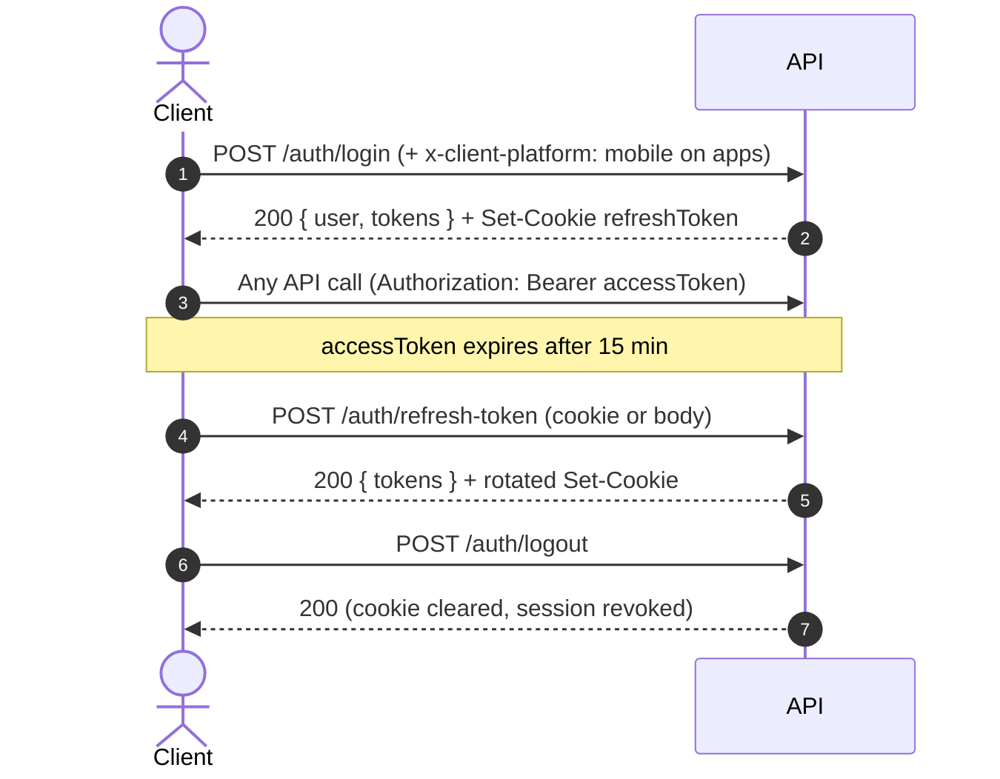

# Deligo Auth API

Integration guide for web and mobile clients. Source of truth: `src/modules/auth/` (`auth.route.ts`, `auth.controller.ts`, `auth.service.ts`, `auth.validation.ts`).

Base URL: `/api/v1` · All bodies are JSON · Protected calls send `Authorization: Bearer <accessToken>`.

---

## 1. Endpoint table

| #   | Method & path                              | Who                     | Auth                   | Purpose                              |
| --- | ------------------------------------------ | ----------------------- | ---------------------- | ------------------------------------ |
| 1   | `POST /auth/signup/initiate`               | Customer                | Public                 | Start signup (email **or** PT phone) |
| 2   | `POST /auth/signup/resend-otp`             | Customer, Driver, Fleet | Public                 | Resend the signup OTP                |
| 3   | `POST /auth/signup/verify-otp`             | Customer, Driver, Fleet | Public                 | Verify OTP, create account, sign in  |
| 4   | `POST /auth/driver/signup/initiate`        | Driver                  | Public                 | Start driver signup (email only)     |
| 5   | `POST /auth/fleet/signup/initiate`         | Fleet manager           | Public                 | Start fleet signup (email only)      |
| 6   | `POST /auth/fleet-manager/signup/initiate` | Fleet manager           | Public                 | Alias of #5                          |
| 7   | `POST /auth/login`                         | Customer                | Public                 | Customer login                       |
| 8   | `POST /auth/driver/login`                  | Driver                  | Public                 | Driver login                         |
| 9   | `POST /auth/fleet/login`                   | Fleet manager           | Public                 | Fleet login                          |
| 10  | `POST /auth/fleet-manager/login`           | Fleet manager           | Public                 | Alias of #9                          |
| 11  | `POST /auth/admin/login`                   | Admin                   | Public                 | Admin / super-admin login            |
| 12  | `POST /auth/google`                        | Customer                | Public                 | Google sign-in                       |
| 13  | `POST /auth/facebook`                      | Customer                | Public                 | Facebook sign-in                     |
| 14  | `POST /auth/apple`                         | Customer                | Public                 | Apple sign-in                        |
| 15  | `POST /auth/admin/create`                  | `ADMIN`, `SUPER_ADMIN`  | Bearer                 | Invite a new admin (see note)        |
| 16  | `POST /auth/admin/set-password`            | Invited admin           | Public (invite token)  | Set password from invite link        |
| 17  | `POST /auth/refresh-token`                 | Any                     | Public (refresh token) | Rotate tokens                        |
| 18  | `POST /auth/logout`                        | Any                     | Optional Bearer        | End the session                      |

Notes:

- Each login endpoint only accepts its own role. Signing in with the wrong role (after the password check) returns `403 "This account is not authorized to sign in to this app."`. `/auth/login` accepts `CUSTOMER` only, `/auth/driver/login` `DRIVER`, `/auth/fleet*/login` `FLEET_MANAGER`, `/auth/admin/login` `ADMIN` (this includes super-admins; `SUPER_ADMIN` is an access label on an `ADMIN` account, not a separate role).
- **`/auth/admin/create` is open to every `ADMIN`**, not only super-admins. Inviting a _regular_ admin works for any admin; **inviting a `SUPER_ADMIN` requires the caller to be a `SUPER_ADMIN`** (`403` otherwise).
- Driver, fleet and customer signups all verify through the same `signup/resend-otp` and `signup/verify-otp` endpoints. The role is fixed server-side when signup is initiated.

---

## 2. Conventions

### Response envelope

```json
{ "success": true, "statusCode": 200, "message": "...", "data": {} }
```

### Error envelope

```json
{
  "success": false,
  "statusCode": 422,
  "message": "Validation failed",
  "code": "VALIDATION_ERROR",
  "errorSources": [
    {
      "path": "contactNumber",
      "message": "Contact number must be a valid Portuguese (+351) phone number"
    }
  ]
}
```

(`stack` is added in development only.)

### Contact fields: `email` or `contactNumber`

Signup, OTP and login all use two explicit, mutually exclusive fields. There is no `identifier` field.

| Field           | Rule                                                                                                                                                                                                                                                                                                                                                   |
| --------------- | ------------------------------------------------------------------------------------------------------------------------------------------------------------------------------------------------------------------------------------------------------------------------------------------------------------------------------------------------------ |
| `email`         | Valid email. Trimmed and lowercased.                                                                                                                                                                                                                                                                                                                   |
| `contactNumber` | Must be a valid **Portuguese (`+351`)** number. National (`912345678`), spaced (`912 345 678`) and international (`+351 912 345 678`) forms are all normalized to E.164 `+351912345678`. Numbers from other countries (e.g. `+8801712345678`, `+14155552671`) are rejected with `422` "Contact number must be a valid Portuguese (+351) phone number". |

Signup and login require **exactly one** (both or neither: `422`). The OTP endpoints accept at most one.

### Password rules

At least 8 characters with an uppercase letter, a lowercase letter, a digit and a special character.

### Authenticated user object

Returned as `data.user` by every login and verify endpoint:

```json
{
  "id": "3665278e-5acf-41e9-939d-1d9f81514a5b",
  "email": "john.doe@example.com",
  "phone": null,
  "firstName": null,
  "lastName": null,
  "role": "CUSTOMER",
  "status": "ACTIVE",
  "profilePicture": null,
  "preferredLanguage": "EN",
  "referralCode": "DLFKCZ3G",
  "isEmailVerified": true,
  "isPhoneVerified": false,
  "createdAt": "2026-11-23T08:00:00.000Z"
}
```

---

## 3. Token delivery (platform-aware)

Access tokens live 15 minutes (`expiresIn: 900`). Refresh tokens live 1 day, or 30 days when `rememberMe: true`.

The refresh token is **always** set as an `httpOnly` cookie named `refreshToken` (path `/api/v1/auth`; `Secure` in production or when `SAMESITE_COOKIE=none`). Whether it is **also** returned in the JSON depends on the client platform:

| Client                                             | How it is detected | Cookie | JSON `tokens`                              |
| -------------------------------------------------- | ------------------ | ------ | ------------------------------------------ |
| **Web** (default: admin & fleet portals, browsers) | No mobile signal   | Yes    | `{ accessToken, expiresIn }`               |
| **Mobile** (Android / iOS apps)                    | See below          | Yes    | `{ accessToken, refreshToken, expiresIn }` |

A request is **mobile** when the first matching rule applies (checked in this order):

1. Header `x-client-platform` or `x-platform` is `mobile`, `android` or `ios` (case-insensitive). Any other value (e.g. `web`) means web and wins over rules 2 and 3.
2. Body contains `"includeRefreshToken": true` (accepted by login, verify-otp, google, facebook, apple and refresh-token).
3. The `User-Agent` is a native HTTP stack (`okhttp`, `Dart`, `CFNetwork`, `Expo`, `ReactNative`). Mobile _browsers_ are web clients.

Mobile apps should store the returned `refreshToken` in SecureStore / Keychain. Browser JavaScript can never read the refresh token. Do not send `x-client-platform` from a browser (it is also not an allowed CORS header).

**`POST /auth/refresh-token` and `POST /auth/logout` accept the refresh token from either the `refreshToken` cookie or the JSON body** (`{ "refreshToken": "..." }`). If both are present the body wins. The response follows the same platform rules.

### Token lifecycle



---

## 4. Customer signup

Flow: **initiate** (returns `signupSessionId`) → **verify-otp** (creates the account and signs in). Keep the `signupSessionId`; it identifies the signup in `resend-otp` and `verify-otp`.

### 4.1 `POST /auth/signup/initiate`

Body (email):

```json
{ "email": "john.doe@example.com", "password": "Password123!", "referralCode": "DLABC123" }
```

Body (Portuguese phone):

```json
{ "contactNumber": "912 345 678", "password": "Password123!" }
```

| Field                          | Required    | Notes                                                        |
| ------------------------------ | ----------- | ------------------------------------------------------------ |
| `email` **or** `contactNumber` | exactly one | See [contact fields](#contact-fields-email-or-contactnumber) |
| `password`                     | yes         | See password rules                                           |
| `referralCode`                 | no          | Another user's code; `400` if unknown                        |

**Not accepted at signup:** `identifier`, `firstName`, `lastName`, `preferredLanguage` (and `otpChannel`, `phone`). Unknown extra fields are ignored, but a body with only `identifier` fails with `422` ("Either email or contactNumber is required"). The account is created with `firstName`/`lastName` = `null` and the default language (`EN`); names are filled in later through the profile endpoints.

Response `200`:

```json
{
  "success": true,
  "statusCode": 200,
  "message": "Verification code sent successfully",
  "data": {
    "signupSessionId": "27b42eec-5bf1-437e-8283-0eed44874e40",
    "channel": "EMAIL",
    "maskedTarget": "j***e@example.com",
    "expiresIn": 300
  }
}
```

`channel` is derived: `email` → `EMAIL` (OTP by email), `contactNumber` → `PHONE` (OTP by SMS). Errors: `409` email/phone already registered, `400` invalid referral code, `422` validation, `429` rate limited.

### 4.2 `POST /auth/signup/resend-otp`

```json
{ "signupSessionId": "27b42eec-5bf1-437e-8283-0eed44874e40" }
```

Optional `email` **or** `contactNumber` (not both): a cross-check that must equal the contact the session was created for, otherwise `400`. The OTP is always resent on the session's original channel (no channel switching). Response `200` has the same `data` shape as initiate (`"message": "Verification code resent successfully"`).

Errors: `404` session expired/unknown, `429` cooldown (60 s between sends) or resend limit (3 per session) reached, `400` contact mismatch, `422` validation.

### 4.3 `POST /auth/signup/verify-otp`

```json
{ "signupSessionId": "27b42eec-5bf1-437e-8283-0eed44874e40", "otp": "123456" }
```

Optional `email` **or** `contactNumber` cross-check (as above) and optional `includeRefreshToken`.

Response `201` (web shown; mobile also gets `tokens.refreshToken`):

```json
{
  "success": true,
  "statusCode": 201,
  "message": "Account verified and created successfully",
  "data": {
    "user": {
      "id": "…",
      "email": "john.doe@example.com",
      "phone": null,
      "firstName": null,
      "lastName": null,
      "role": "CUSTOMER",
      "status": "ACTIVE",
      "preferredLanguage": "EN",
      "isEmailVerified": true,
      "isPhoneVerified": false,
      "…": "…"
    },
    "tokens": { "accessToken": "eyJhbGciOi…", "expiresIn": 900 }
  }
}
```

A phone signup creates the user with `phone` = `+351…`, `email` = `null`, `isPhoneVerified: true`. Account creation is one database transaction: `User` + credentials `Account` + `CustomerProfile` + `Wallet` (0.00).

Errors: `404` session expired, `400` wrong code (`"Invalid verification code"`; the remaining-attempt count is not returned to the client), expired code or contact mismatch, `429` too many wrong codes (the session is destroyed after 5), `409` the email/phone was registered in the meantime.

---

## 5. Driver & fleet manager signup

Email-only, no names or phone. Body for both:

```json
{ "email": "john.driver@example.com", "password": "Password123!", "referralCode": "DL123456" }
```

| Endpoint                                                                         | Role created    |
| -------------------------------------------------------------------------------- | --------------- |
| `POST /auth/driver/signup/initiate`                                              | `DRIVER`        |
| `POST /auth/fleet/signup/initiate` (alias `/auth/fleet-manager/signup/initiate`) | `FLEET_MANAGER` |

`contactNumber`, `firstName`, `lastName` and `preferredLanguage` are not accepted (a `contactNumber` without `email` fails `422`). The OTP is always sent by email. The response is the same as customer initiate; then use the shared `signup/resend-otp` and `signup/verify-otp` (section 4).

On verify the server also creates the role profile:

- **Driver:** `DriverProfile` with `kycStatus: NOT_SUBMITTED`, `isAvailable: false` (the driver must complete KYC before accepting rides).
- **Fleet manager:** `FleetManagerProfile` with `verificationStatus: PENDING_VERIFICATION` (completed through `/fleet/onboarding/*`).

---

## 6. Login

All logins share one body. Provide exactly one of `email` / `contactNumber`:

```json
{ "email": "john.doe@example.com", "password": "Password123!", "rememberMe": true }
```

```json
{ "contactNumber": "+351 912 345 678", "password": "Password123!" }
```

| Field                          | Required             | Notes                                             |
| ------------------------------ | -------------------- | ------------------------------------------------- |
| `email` **or** `contactNumber` | exactly one          | `identifier` is no longer accepted (`422`)        |
| `password`                     | yes                  |                                                   |
| `rememberMe`                   | no (default `false`) | Cookie / refresh token lasts 30 days instead of 1 |
| `includeRefreshToken`          | no                   | Forces mobile-style token delivery                |

Endpoints: `/auth/login` (customer), `/auth/driver/login`, `/auth/fleet/login` (alias `/auth/fleet-manager/login`), `/auth/admin/login`.

Response `200`:

```json
{
  "success": true,
  "statusCode": 200,
  "message": "Logged in successfully",
  "data": {
    "user": { "id": "…", "role": "CUSTOMER", "status": "ACTIVE", "…": "…" },
    "tokens": { "accessToken": "eyJhbGciOi…", "expiresIn": 900 }
  }
}
```

(Mobile requests also get `tokens.refreshToken`.)

Errors: `401 "Invalid credentials"` (unknown user, wrong password or no password on the account; the same message and timing for all), `403` wrong role for this endpoint, `403` account `SUSPENDED` / `DEACTIVATED` / `PENDING_VERIFICATION`, `422` validation, `429` rate limited. A login by phone only matches numbers stored in `+351…` form.

---

## 7. Social sign-in (customers)

All three create (or link to) a `CUSTOMER` account and return the same payload and platform-aware tokens as login (`message` e.g. "Logged in with Google successfully").

| Endpoint              | Required body                                                                                 | Server-side verification                                                                                                                                                                                                                                                       |
| --------------------- | --------------------------------------------------------------------------------------------- | ------------------------------------------------------------------------------------------------------------------------------------------------------------------------------------------------------------------------------------------------------------------------------ |
| `POST /auth/google`   | `idToken`                                                                                     | Google ID token, audience checked against the web/Android/iOS client IDs; email must be verified                                                                                                                                                                               |
| `POST /auth/facebook` | `accessToken`                                                                                 | Facebook Graph API `/me` lookup                                                                                                                                                                                                                                                |
| `POST /auth/apple`    | `idToken`, optional `user: { firstName, lastName }` (Apple sends names only on first sign-in) | Apple JWKS signature, issuer (`https://appleid.apple.com`) and audience (`APPLE_CLIENT_ID` / `APPLE_BUNDLE_ID`). In non-production with `APPLE_DEMO_MODE=true`, tokens of the form `demo_apple_token_<name>` are accepted for testing; they are always rejected in production. |

Common optional fields: `referralCode`, `preferredLanguage` (`EN` | `PT`, default `EN`), `rememberMe` (default `true`), `includeRefreshToken`.

Behaviour:

- A provider account that is already linked signs in directly (blocked if suspended, deactivated or pending).
- **Email matches an existing account** (only when the provider verified the email): linking is allowed for `CUSTOMER` accounts only (`403 "Social login is not allowed for this account."` for other roles or accounts pending verification). If that existing account had **not** verified its email, the email is marked verified **and its password credentials are disabled** (pre-account-takeover protection); the user can then sign in with the provider.
- Otherwise a new active `CUSTOMER` is created (with `CustomerProfile` and `Wallet`). Names come from the provider, with fallbacks.
- Facebook sign-ins are always recorded as email-**unverified**.

Errors: `401` invalid/unverifiable provider token, `400` invalid referral code, `403` as above.

---

## 8. Admin invitation & password setup

### 8.1 `POST /auth/admin/create` (Bearer, `ADMIN` or `SUPER_ADMIN`)

```json
{ "firstName": "Sub", "lastName": "Admin", "email": "subadmin@example.com", "role": "ADMIN" }
```

`role` is `ADMIN` (default) or `SUPER_ADMIN`. Only a `SUPER_ADMIN` can invite a `SUPER_ADMIN` (`403 "Only a SUPER_ADMIN can create another SUPER_ADMIN"`). The new account is created `PENDING_VERIFICATION` (cannot log in yet) and a one-time invite link, valid **24 hours**, is emailed to `<ADMIN_FRONTEND_URL>/set-password?token=…`. Response `201`:

```json
{
  "success": true,
  "statusCode": 201,
  "message": "Admin invitation sent successfully",
  "data": {
    "user": { "id": "…", "role": "ADMIN", "status": "PENDING_VERIFICATION", "…": "…" },
    "message": "Admin created. Invitation link sent to email."
  }
}
```

Errors: `401`/`403` (not an admin), `409` email already exists, `422`, `500 EMAIL_DELIVERY_FAILED` when the invitation email cannot be delivered (the invite token is discarded; a failed send is only logged outside production).

### 8.2 `POST /auth/admin/set-password` (public)

```json
{ "token": "<token from the invite link>", "password": "NewAdminPassword123!" }
```

Activates the account (`ACTIVE`, email verified), stores the password, deletes the token (single use) and revokes any existing sessions. Response `200` `"Password set successfully. You can now log in."`. Invalid/expired/used token: `400 "Invalid or expired invitation link"`. The admin then signs in at `/auth/admin/login`.

---

## 9. Refresh & logout

### 9.1 `POST /auth/refresh-token`

Cookie-only (web) or body (mobile). The body is optional:

```json
{ "refreshToken": "eyJhbGciOi…" }
```

Response `200` (web shown; mobile also gets `tokens.refreshToken`). The cookie is rotated in both cases:

```json
{
  "success": true,
  "statusCode": 200,
  "message": "Token refreshed successfully",
  "data": { "tokens": { "accessToken": "eyJhbGciOi…", "expiresIn": 900 } }
}
```

Every refresh **rotates** the refresh token; the old one is revoked. Presenting an already-used/revoked token is treated as theft and **revokes all of that user's sessions** (`401`). Errors: `401` missing / invalid / expired refresh token or reuse detected, `403` account no longer active.

### 9.2 `POST /auth/logout`

Send the Bearer token and/or the refresh token (cookie or `{ "refreshToken": "..." }` body); either is enough, and a missing/expired access token does not block logout. Revokes the session, blacklists the access token's `jti` in Redis, disconnects the session's sockets and clears the cookie. It also clears the user's FCM push token so a signed-out device stops receiving pushes. Optional body fields: `fcmToken` (clear only that device's token) and `clearFcmToken: false` (keep the token). Response `200`:

```json
{
  "success": true,
  "statusCode": 200,
  "message": "Logged out successfully",
  "data": { "message": "Successfully logged out" }
}
```

---

## 10. Security, limits & account lifecycle

### Signup session & OTP (Redis)

| Item           | Value                                                                                                                                                                                                                                                                                  |
| -------------- | -------------------------------------------------------------------------------------------------------------------------------------------------------------------------------------------------------------------------------------------------------------------------------------- |
| Pending signup | `signup:session:<signupSessionId>` holds `{ email? , contactNumber? (E.164), passwordHash, referralCode, referrerId, role }` plus the OTP hash. The session **TTL is 15 min** (`SIGNUP_SESSION_TTL_SECONDS`, default 900). Nothing is written to PostgreSQL until the OTP is verified. |
| OTP            | 6 digits, stored hashed (SHA-256), compared in constant time. Valid for **5 min** (`OTP_EXPIRES_IN_SECONDS`, default 300).                                                                                                                                                             |
| Resend         | 60 s cooldown, max 3 resends per session; a resend invalidates the previous code and resets the attempt counter.                                                                                                                                                                       |
| Wrong codes    | 5 wrong attempts destroy the session (`429`); restart signup.                                                                                                                                                                                                                          |
| Password       | bcrypt (`BCRYPT_SALT_ROUNDS`); only the hash is kept in Redis/PostgreSQL.                                                                                                                                                                                                              |
| Language       | OTP email/SMS text uses the default language (`EN`); the greeting is "Hello!" (no name is collected).                                                                                                                                                                                  |

### Rate limiting

Every auth route except `refresh-token` and `logout` uses the strict `auth` limiter (Redis, `rl:auth:*` keys; if Redis is down it fails open). Buckets, per 15-minute window:

- **20 requests per IP per route**, and
- **10 requests per account identity**, keyed by the **canonical** value so formatting tricks do not create new buckets: lower-cased `email`, `contactNumber` reduced to digits (so `912 345 678`, `+351912345678` and `+351 912 345 678` share one bucket), `signupSessionId`, or the admin invite `token`. Identity values are hashed in the keys.

Exceeding a limit returns `429 RATE_LIMIT_EXCEEDED` with `Retry-After` and `RateLimit-*` headers. All `/api/v1` traffic is additionally capped at 120 requests/min per IP.

### Sessions & tokens

- Each login creates a PostgreSQL `Session` row storing only the SHA-256 hash of the refresh token (plus user agent, IP, expiry); multiple devices are supported.
- Logout, refresh rotation, password set, suspension and reuse detection revoke sessions; revoked sessions' access tokens are rejected immediately through Redis markers.
- Login compares against a dummy hash when the user does not exist, so response time and message do not reveal whether an account exists.

### Initial account status

| Account                     | Initial `User.status`  | What gates real use                                                                                                   |
| --------------------------- | ---------------------- | --------------------------------------------------------------------------------------------------------------------- |
| Customer (signup or social) | `ACTIVE`               | Can sign in and request rides immediately                                                                             |
| Driver                      | `ACTIVE`               | `DriverProfile.kycStatus` starts `NOT_SUBMITTED`; a driver cannot accept rides until KYC is `APPROVED` (see `/kyc/*`) |
| Fleet manager               | `ACTIVE`               | `FleetManagerProfile.verificationStatus` starts `PENDING_VERIFICATION` until an admin approves the onboarding         |
| Admin (invited)             | `PENDING_VERIFICATION` | Cannot log in until the invite password is set, then `ACTIVE`                                                         |

Login is refused with `403` for `SUSPENDED`, `DEACTIVATED` and `PENDING_VERIFICATION` accounts, and `refresh-token` returns `403` for non-active users.

### Status codes

| Code          | Meaning in auth                                                                                                                      |
| ------------- | ------------------------------------------------------------------------------------------------------------------------------------ |
| `200` / `201` | Success (`201` only for verify-otp and admin create)                                                                                 |
| `400`         | Wrong/expired OTP, contact does not match the session, invalid referral code, invalid/expired admin invite                           |
| `401`         | Invalid credentials, missing/invalid/expired/reused refresh token, invalid social token, missing/invalid Bearer on admin create      |
| `403`         | Wrong role for the endpoint, account suspended/deactivated/pending, social login not allowed, non-super-admin inviting a super-admin |
| `404`         | Signup session expired or unknown                                                                                                    |
| `409`         | Email or phone already registered                                                                                                    |
| `422`         | Validation failed (including non-Portuguese `contactNumber`, both or neither of `email`/`contactNumber`, legacy `identifier`)        |
| `429`         | Rate limit, OTP cooldown, resend limit or too many wrong OTPs                                                                        |

---

## 11. Environment variables

| Variable                                                                                  | Purpose                                                 |
| ----------------------------------------------------------------------------------------- | ------------------------------------------------------- |
| `JWT_ACCESS_SECRET`, `JWT_ACCESS_EXPIRES_IN`                                              | Access token signing key / lifetime (`15m`)             |
| `JWT_REFRESH_SECRET`, `JWT_REFRESH_EXPIRES_IN_DEFAULT`, `JWT_REFRESH_EXPIRES_IN_REMEMBER` | Refresh token key / lifetimes (`1d`, `30d`)             |
| `JWT_SECRET`, `JWT_EXPIRES_IN`                                                            | Legacy fallback while `JWT_ACCESS_SECRET` is unset      |
| `OTP_EXPIRES_IN_SECONDS`, `SIGNUP_SESSION_TTL_SECONDS`                                    | OTP validity (300) and signup session TTL (900)         |
| `SAMESITE_COOKIE`                                                                         | `lax` (default), `strict` or `none` (forces `Secure`)   |
| `BCRYPT_SALT_ROUNDS`                                                                      | Password hashing cost                                   |
| `SMTP_*`, `EMAIL_FROM_NAME`, `EMAIL_FROM_ADDRESS`                                         | OTP, welcome and admin-invite emails                    |
| `BULKGATE_APPLICATION_ID`, `BULKGATE_APPLICATION_TOKEN`                                   | SMS OTP delivery                                        |
| `GOOGLE_CLIENT_ID`, `GOOGLE_ANDROID_CLIENT_ID`, `GOOGLE_IOS_CLIENT_ID`                    | Google token audiences                                  |
| `FACEBOOK_APP_ID`, `FACEBOOK_APP_SECRET`                                                  | Facebook token lookup                                   |
| `APPLE_CLIENT_ID`, `APPLE_BUNDLE_ID`, `APPLE_DEMO_MODE`                                   | Apple audiences (demo mode is forced off in production) |
| `ADMIN_FRONTEND_URL`                                                                      | Base URL of the admin invite link                       |

See `.env.example` for the full list and production requirements.

---

## 12. Emails

`src/utils/email.service.ts` (Nodemailer, pooled; logs a preview instead of failing when SMTP is not configured) renders EJS templates from `src/templates/emails/`:

- `otp-verification.ejs`: signup OTP ("Hello!" when no name is available)
- `welcome.ejs`: sent (non-blocking) after a customer/driver/fleet account is created
- `admin-invite.ejs`: admin invite link
- `layout.ejs`: shared responsive wrapper

---

## 13. Quick cURL examples

```bash
# Customer signup by email, then verify
curl -X POST http://localhost:5000/api/v1/auth/signup/initiate \
  -H 'Content-Type: application/json' \
  -d '{ "email": "maria@example.com", "password": "Password123!" }'

curl -X POST http://localhost:5000/api/v1/auth/signup/verify-otp \
  -H 'Content-Type: application/json' \
  -d '{ "signupSessionId": "<SIGNUP_SESSION_ID>", "otp": "<6_DIGIT_OTP>" }'

# Customer signup by Portuguese phone
curl -X POST http://localhost:5000/api/v1/auth/signup/initiate \
  -H 'Content-Type: application/json' \
  -d '{ "contactNumber": "912 345 678", "password": "Password123!" }'

# Web login (refresh token only in the cookie; -c saves it)
curl -c cookies.txt -X POST http://localhost:5000/api/v1/auth/login \
  -H 'Content-Type: application/json' \
  -d '{ "email": "maria@example.com", "password": "Password123!" }'

# Mobile login (refresh token also in the JSON)
curl -X POST http://localhost:5000/api/v1/auth/login \
  -H 'Content-Type: application/json' -H 'x-client-platform: mobile' \
  -d '{ "contactNumber": "+351912345678", "password": "Password123!" }'

# Refresh with the cookie (web) or with the body (mobile)
curl -b cookies.txt -c cookies.txt -X POST http://localhost:5000/api/v1/auth/refresh-token
curl -X POST http://localhost:5000/api/v1/auth/refresh-token \
  -H 'Content-Type: application/json' -H 'x-client-platform: mobile' \
  -d '{ "refreshToken": "<REFRESH_TOKEN>" }'

# Logout
curl -b cookies.txt -X POST http://localhost:5000/api/v1/auth/logout \
  -H "Authorization: Bearer <ACCESS_TOKEN>"
```

A ready-to-run Postman collection (`deligo-postman-collection.json`) covers every endpoint above, including the mobile (`x-client-platform: mobile`) variants.
