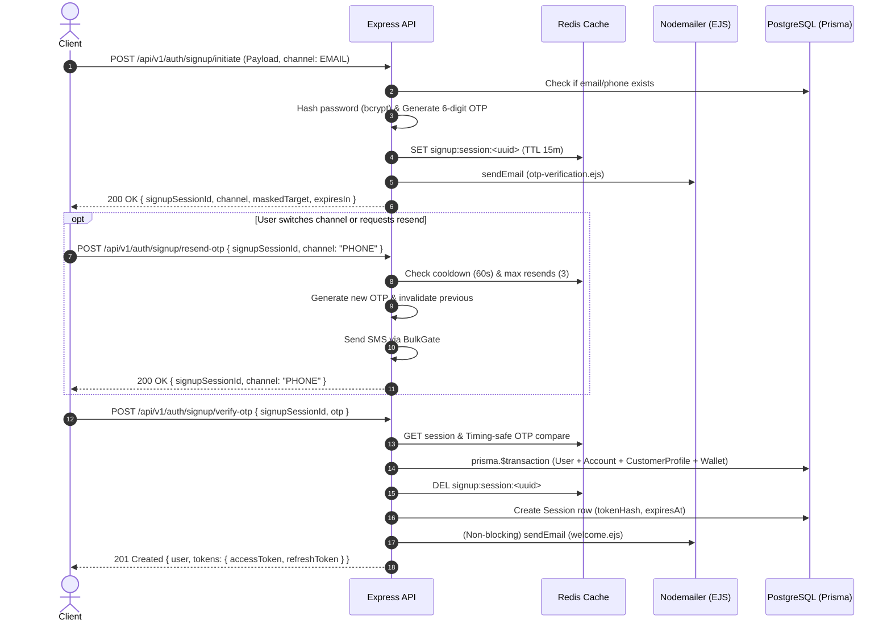
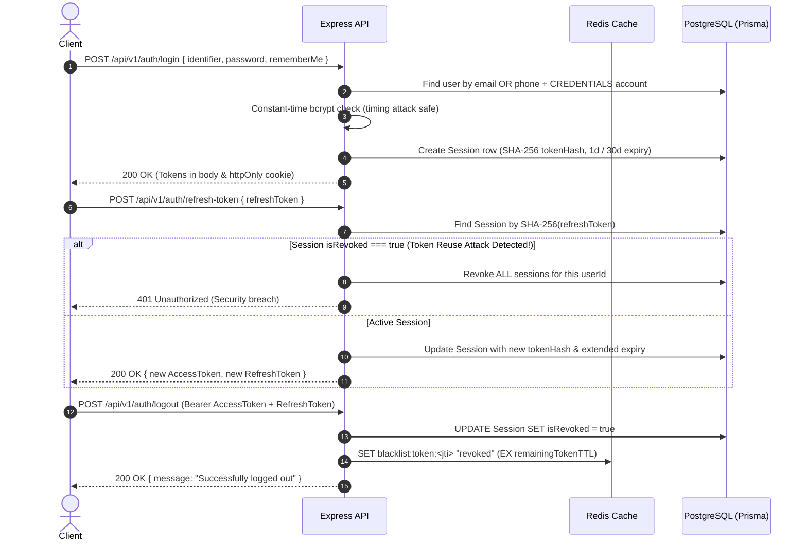
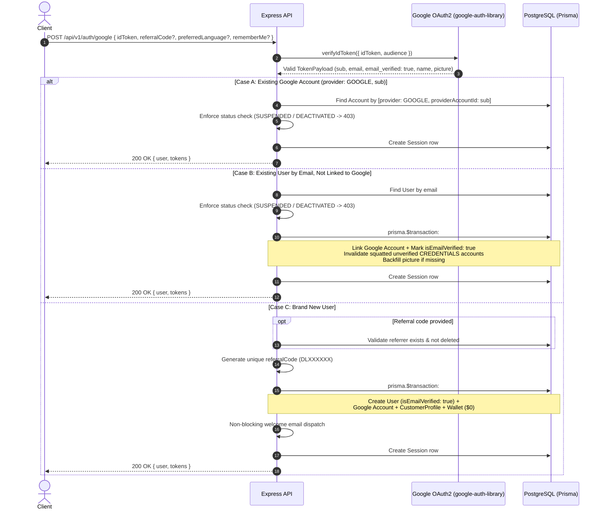

# Deligo Authentication & Email Service Documentation

This document describes the architecture, database models, security mechanisms, API routes, email templates, and testing procedures for the **Authentication**, **Session Management**, and **Nodemailer + EJS Email Service** in the Deligo Ride-Sharing Backend.

---

## 1. Architecture & Security Overview

### Key Highlights
- **Locked Prisma Schema Compliance**: Strictly adheres to existing `User`, `Account`, `Session`, `CustomerProfile`, and `Wallet` models.
- **Two-Step Registration with OTP**: Pending registrations reside in Redis (`signup:session:<id>`) with a 15-minute TTL until verified. Only upon successful OTP verification is the user committed to PostgreSQL atomically.
- **Dynamic Channel Switching**: Users can switch between `EMAIL` and `PHONE` verification on the fly, with rate-limiting cooldowns (60s) and max resend limits (3 attempts).
- **Atomic Database Writes**: `prisma.$transaction` guarantees that `User`, `Account` (provider `CREDENTIALS`), `CustomerProfile`, and `Wallet` (USD 0.00) are created together or rolled back. Unique referral codes (`DLXXXXXX`) are generated automatically.
- **Multi-Device Session Management**: Each login or signup issues a cryptographically signed Access Token (15m) and Refresh Token (1d default, 30d if `rememberMe`). Refresh token hashes (`SHA-256`) are persisted in the PostgreSQL `Session` table.
- **Token Rotation & Breach Detection**: Every refresh rotates the refresh token. If a previously rotated (or revoked) token is presented, the system detects a token reuse attack and revokes **all** active sessions for that user.
- **Instant Logout via Blacklisting**: Logout revokes the session in PostgreSQL and immediately blacklists the Access Token's `jti` in Redis for its remaining lifespan. The `authenticate` middleware rejects blacklisted tokens.
- **Timing Attack Prevention**: Login uses a dummy `bcrypt` comparison when an identifier is not found, mitigating timing-based user enumeration.
- **Production-Grade Nodemailer & EJS**: Employs connection pooling (`pool: true`), a responsive `layout.ejs` wrapper, multi-language support (`EN` / `PT`), and structured error handling that avoids unhandled promise crashes.

---

## 2. Mermaid Sequence Diagrams

### A. Signup & OTP Verification Flow



### B. Login, Token Refresh & Logout Flow



### C. Google Sign-In Flow (Account Linking & Pre-Account Takeover Protection)



---

## 3. Environment Variables Reference

Add the following to your `.env` file (see `.env.example`):

```bash
# JWT Configuration
JWT_ACCESS_SECRET="your_super_secret_jwt_access_key_here_at_least_32_characters"
JWT_ACCESS_EXPIRES_IN="15m"
JWT_REFRESH_SECRET="your_super_secret_refresh_key_here_at_least_32_characters"
JWT_REFRESH_EXPIRES_IN_DEFAULT="1d"
JWT_REFRESH_EXPIRES_IN_REMEMBER="30d"

# OTP & Registration Session Configuration
OTP_EXPIRES_IN_SECONDS=300
SIGNUP_SESSION_TTL_SECONDS=900

# SMTP / Nodemailer Email Service
SMTP_HOST="smtp.gmail.com"
SMTP_PORT=587
SMTP_SECURE=false
SMTP_USER="your_email@gmail.com"
SMTP_PASS="your_app_password"
EMAIL_FROM_NAME="Deligo Ride"
EMAIL_FROM_ADDRESS="noreply@deligo.com"

# Google OAuth
GOOGLE_CLIENT_ID="your_google_client_id.apps.googleusercontent.com"
GOOGLE_ANDROID_CLIENT_ID="your_android_client_id_optional"
GOOGLE_IOS_CLIENT_ID="your_ios_client_id_optional"
```

---

## 4. API Endpoints Reference

Base path: `/api/v1/auth`

### 1. Initiate Signup
- **Method**: `POST`
- **Path**: `/api/v1/auth/signup/initiate`
- **Auth**: Public
- **Request Body**:
```json
{
  "firstName": "John",
  "lastName": "Doe",
  "email": "john.doe@example.com",
  "phone": "+15551234567",
  "password": "Password123!",
  "preferredLanguage": "EN",
  "referralCode": "DLABC123",
  "otpChannel": "EMAIL"
}
```
*Note: At least one of `email` or `phone` is required. `otpChannel` can be `EMAIL` or `PHONE`.*

- **Response (200 OK)**:
```json
{
  "success": true,
  "data": {
    "signupSessionId": "27b42eec-5bf1-437e-8283-0eed44874e40",
    "channel": "EMAIL",
    "maskedTarget": "j***e@example.com",
    "expiresIn": 300
  }
}
```

---

### 2. Resend OTP (with Channel Switching)
- **Method**: `POST`
- **Path**: `/api/v1/auth/signup/resend-otp`
- **Auth**: Public
- **Request Body**:
```json
{
  "signupSessionId": "27b42eec-5bf1-437e-8283-0eed44874e40",
  "channel": "PHONE"
}
```
*Note: Omitting `channel` resends on the current channel. Enforces a 60-second cooldown and a maximum of 3 resends per session.*

- **Response (200 OK)**:
```json
{
  "success": true,
  "data": {
    "signupSessionId": "27b42eec-5bf1-437e-8283-0eed44874e40",
    "channel": "PHONE",
    "maskedTarget": "+15***67",
    "expiresIn": 300
  }
}
```

---

### 3. Verify OTP & Complete Signup
- **Method**: `POST`
- **Path**: `/api/v1/auth/signup/verify-otp`
- **Auth**: Public
- **Request Body**:
```json
{
  "signupSessionId": "27b42eec-5bf1-437e-8283-0eed44874e40",
  "otp": "123456"
}
```

- **Response (201 Created)**:
```json
{
  "success": true,
  "data": {
    "user": {
      "id": "3665278e-5acf-41e9-939d-1d9f81514a5b",
      "email": "john.doe@example.com",
      "phone": "+15551234567",
      "firstName": "John",
      "lastName": "Doe",
      "role": "CUSTOMER",
      "status": "ACTIVE",
      "profilePicture": null,
      "preferredLanguage": "EN",
      "referralCode": "DLFKCZ3G",
      "isEmailVerified": true,
      "isPhoneVerified": false,
      "createdAt": "2026-11-17T09:00:00.000Z"
    },
    "tokens": {
      "accessToken": "eyJhbGciOiJIUzI1NiIsIn...",
      "refreshToken": "eyJhbGciOiJIUzI1NiIsIn...",
      "expiresIn": 900
    }
  }
}
```
*(Also sets `refreshToken` in `httpOnly` secure cookie).*

---

### 4. Login (Email or Phone)
- **Method**: `POST`
- **Path**: `/api/v1/auth/login`
- **Auth**: Public
- **Request Body**:
```json
{
  "identifier": "john.doe@example.com",
  "password": "Password123!",
  "rememberMe": true
}
```
*Note: `identifier` accepts either the user's registered email or phone number.*

- **Response (200 OK)**:
```json
{
  "success": true,
  "data": {
    "user": { ... },
    "tokens": {
      "accessToken": "eyJhbGciOiJIUzI1NiIsIn...",
      "refreshToken": "eyJhbGciOiJIUzI1NiIsIn...",
      "expiresIn": 900
    }
  }
}
```

---

### 5. Driver Signup Initiation
- **Method**: `POST`
- **Path**: `/api/v1/auth/driver/signup/initiate`
- **Auth**: Public
- **Request Body**:
```json
{
  "firstName": "John",
  "lastName": "Driver",
  "email": "john.driver@example.com",
  "phone": "+15559876543",
  "password": "Password123!",
  "preferredLanguage": "EN",
  "referralCode": "DL123456",
  "otpChannel": "EMAIL"
}
```
*Note: The server strictly hardcodes `role: "DRIVER"` in the Redis session and never trusts role input from the client. After OTP verification via `/auth/signup/verify-otp`, a `DriverProfile` row is created automatically and `User.status` is set to `ACTIVE`.*

- **Response (200 OK)**:
```json
{
  "success": true,
  "data": {
    "signupSessionId": "4bf729bc-4b36-47b1-9f93-c423cb11210a",
    "channel": "EMAIL",
    "maskedTarget": "j***r@example.com",
    "expiresIn": 300
  }
}
```

---

### 6. Driver Login
- **Method**: `POST`
- **Path**: `/api/v1/auth/driver/login`
- **Auth**: Public
- **Request Body**:
```json
{
  "identifier": "john.driver@example.com",
  "password": "Password123!",
  "rememberMe": true
}
```
*Note: Validates driver credentials and enforces role isolation. Non-driver accounts attempting to sign in here are rejected with `403 Forbidden` (`This account is not authorized to sign in to this app.`) after timing-safe password verification.*

- **Response (200 OK)**:
```json
{
  "success": true,
  "data": {
    "user": {
      "id": "8dcc91ec-0b15-4293-b15a-39649139c226",
      "email": "john.driver@example.com",
      "phone": "+15559876543",
      "firstName": "John",
      "lastName": "Driver",
      "role": "DRIVER",
      "status": "ACTIVE",
      "referralCode": "DL99XYZ1",
      "isEmailVerified": true,
      "isPhoneVerified": false,
      "createdAt": "2026-11-21T08:00:00.000Z"
    },
    "tokens": {
      "accessToken": "eyJhbGciOiJIUzI1NiIsIn...",
      "refreshToken": "eyJhbGciOiJIUzI1NiIsIn...",
      "expiresIn": 900
    }
  }
}
```
*(Sets `refreshToken` in `httpOnly` secure cookie).*

---

### 7. Google Sign-In
- **Method**: `POST`
- **Path**: `/api/v1/auth/google`
- **Auth**: Public
- **Request Body**:
```json
{
  "idToken": "<GOOGLE_ID_TOKEN_FROM_CLIENT_SDK>",
  "referralCode": "DLABC123",
  "preferredLanguage": "EN",
  "rememberMe": true
}
```
*Note: `idToken` is verified against configured Google Client IDs using `google-auth-library`. `rememberMe` defaults to `true` (30 days).*

- **Response (200 OK)**:
```json
{
  "success": true,
  "data": {
    "user": {
      "id": "3665278e-5acf-41e9-939d-1d9f81514a5b",
      "email": "user@gmail.com",
      "firstName": "John",
      "lastName": "Doe",
      "role": "CUSTOMER",
      "status": "ACTIVE",
      "profilePicture": "https://lh3.googleusercontent.com/photo.jpg",
      "preferredLanguage": "EN",
      "referralCode": "DLFKCZ3G",
      "isEmailVerified": true,
      "isPhoneVerified": false,
      "createdAt": "2026-11-18T08:00:00.000Z"
    },
    "tokens": {
      "accessToken": "eyJhbGciOiJIUzI1NiIsIn...",
      "refreshToken": "eyJhbGciOiJIUzI1NiIsIn...",
      "expiresIn": 900
    }
  }
}
```

---

### 6. Rotate Refresh Token
- **Method**: `POST`
- **Path**: `/api/v1/auth/refresh-token`
- **Auth**: Public (Requires refresh token in cookie or body)
- **Request Body** (optional if cookie is sent):
```json
{
  "refreshToken": "eyJhbGciOiJIUzI1NiIsIn..."
}
```

- **Response (200 OK)**:
```json
{
  "success": true,
  "data": {
    "tokens": {
      "accessToken": "eyJhbGciOiJIUzI1NiIsIn...",
      "refreshToken": "eyJhbGciOiJIUzI1NiIsIn...",
      "expiresIn": 900
    }
  }
}
```

---

### 7. Logout
- **Method**: `POST`
- **Path**: `/api/v1/auth/logout`
- **Headers**: `Authorization: Bearer <accessToken>`
- **Request Body** (optional): `{ "refreshToken": "..." }`
- **Response (200 OK)**:
```json
{
  "success": true,
  "data": {
    "message": "Successfully logged out"
  }
}
```

---

### 8. Admin Login
- **Method**: `POST`
- **Path**: `/api/v1/auth/admin/login`
- **Auth**: Public
- **Request Body**:
```json
{
  "identifier": "admin@deligo.com",
  "password": "AdminPassword123!",
  "rememberMe": true
}
```
*Note: Only accounts with `role: "ADMIN"` (including `SUPER_ADMIN` and `SUPPORT` access labels) are authorized to log in through this endpoint. Non-admin users attempting to log in are rejected with `403 Forbidden` (`This account is not authorized to sign in to this app.`) after password verification.*

- **Response (200 OK)**:
```json
{
  "success": true,
  "data": {
    "user": {
      "id": "e4b5c7d8-1111-4293-b15a-39649139c226",
      "email": "admin@deligo.com",
      "firstName": "Super",
      "lastName": "Admin",
      "role": "ADMIN",
      "status": "ACTIVE",
      "referralCode": "AD123456",
      "isEmailVerified": true,
      "isPhoneVerified": false,
      "createdAt": "2026-11-21T08:00:00.000Z"
    },
    "tokens": {
      "accessToken": "eyJhbGciOiJIUzI1NiIsIn...",
      "refreshToken": "eyJhbGciOiJIUzI1NiIsIn...",
      "expiresIn": 900
    }
  }
}
```
*(Sets `refreshToken` in `httpOnly` secure cookie).*

---

### 9. Admin Invitation (Create Admin)
- **Method**: `POST`
- **Path**: `/api/v1/auth/admin/create`
- **Auth**: Authenticated (`ADMIN` or `SUPER_ADMIN`)
- **Headers**: `Authorization: Bearer <adminAccessToken>`
- **Request Body**:
```json
{
  "firstName": "Claire",
  "lastName": "Underwood",
  "email": "claire.underwood@deligo.com",
  "role": "ADMIN"
}
```
*Security & Business Rules:*
1. **Privilege Escalation Protection**: An `ADMIN` can only invite another `ADMIN` (`SUPPORT`). Only a `SUPER_ADMIN` can invite a `SUPER_ADMIN`. An `ADMIN` attempting to invite a `SUPER_ADMIN` is rejected with `403 Forbidden`.
2. **Account Status**: Created with `status: "PENDING_VERIFICATION"` and `isEmailVerified: false`. Login is prevented until the setup link is completed.
3. **Audit Trail**: The creator's user ID is saved in `referrerId`.
4. **One-Time Token**: A cryptographically secure 32-byte hex token is generated. Its SHA-256 hash is stored in Redis (`admin:invite:${tokenHash}`) with a 24-hour TTL (`86400`s). A setup link containing the raw token is emailed to the invitee using the `admin-invite` EJS template.

- **Response (201 Created)**:
```json
{
  "success": true,
  "data": {
    "user": {
      "id": "c1f7a28e-3241-45f8-bca7-817c1825fae1",
      "email": "claire.underwood@deligo.com",
      "firstName": "Claire",
      "lastName": "Underwood",
      "role": "ADMIN",
      "status": "PENDING_VERIFICATION",
      "referralCode": "CL123456",
      "referrerId": "e4b5c7d8-1111-4293-b15a-39649139c226",
      "isEmailVerified": false,
      "createdAt": "2026-11-21T08:00:00.000Z"
    },
    "message": "Admin created. Invitation link sent to email."
  }
}
```

---

### 10. Admin Set Password (One-Time Invite Link)
- **Method**: `POST`
- **Path**: `/api/v1/auth/admin/set-password`
- **Auth**: Public
- **Request Body**:
```json
{
  "token": "7a8b9c0d1e2f3a4b5c6d7e8f9a0b1c2d3e4f5a6b7c8d9e0f1a2b3c4d5e6f7a8b",
  "password": "StrongAdminPassword123!"
}
```
*Security Rules:*
1. **Token Validation**: The raw token is hashed via SHA-256 and matched against Redis (`admin:invite:${tokenHash}`). Rejects with `400 Bad Request` if invalid or expired.
2. **Replay Protection**: The Redis key is deleted immediately upon successful password configuration to prevent reuse.
3. **Activation**: Atomically activates the user (`status: "ACTIVE"`, `isEmailVerified: true`) and creates/updates their `CREDENTIALS` `Account`.

- **Response (200 OK)**:
```json
{
  "success": true,
  "data": {
    "message": "Password set successfully. You can now log in."
  }
}
```

---

## 5. Email Service Details (`src/utils/email.service.ts`)

### Features
1. **Singleton Transporter**: Built with `pool: true` to reuse connections and avoid per-message TLS handshake overhead.
2. **Safe Fallback**: In environments where SMTP credentials are not yet configured (e.g. fresh local development), emails log rich previews to the console without crashing or throwing.
3. **Template Engine**:
   - `src/templates/emails/layout.ejs`: Base HTML container with Deligo branding and mobile-responsive styles.
   - `src/templates/emails/otp-verification.ejs`: High-contrast verification code card, expiry indicator, anti-phishing warnings, and full bilingual support (`EN` / `PT`).
   - `src/templates/emails/welcome.ejs`: Onboarding email featuring the user's unique referral code and call-to-action button.

### Usage Example
```typescript
import { sendEmail } from '../utils/email.service';

await sendEmail({
  to: 'user@example.com',
  subject: 'Verify Your Deligo Account',
  template: 'otp-verification',
  data: {
    name: 'Alex',
    otpCode: '482910',
    expiryMinutes: 5,
    preferredLanguage: 'EN', // or 'PT'
  },
});
```

---

## 6. Testing Guide

### Automated End-to-End Test Suite
Automated integration test scripts cover all authentication scenarios:
```bash
# 1. Run the Registration, OTP, Login, Refresh, and Logout test suite:
npx ts-node scripts/test-auth-e2e.ts

# 2. Run the Driver Authentication test suite (Role Isolation, KYC status, Customer vs. Driver guard):
npx ts-node scripts/test-driver-auth.ts

# 3. Run the Admin Authentication & Invite Setup test suite (Privilege escalation, 1-time token, activation):
npx ts-node scripts/test-admin-auth.ts

# 4. Run the Google Sign-In test suite (Cases A, B, C & Pre-Account Takeover Protection):
npx ts-node scripts/test-google-auth.ts

# 5. Run the Facebook & Apple Social Sign-In test suite:
npx ts-node scripts/test-social-auth.ts
```

### Manual cURL Commands

#### 1. Initiate Signup
```bash
curl -X POST http://localhost:3000/api/v1/auth/signup/initiate \
  -H "Content-Type: application/json" \
  -d '{
    "firstName": "Maria",
    "lastName": "Santos",
    "email": "maria.santos@example.com",
    "phone": "+5511999998888",
    "password": "Password123!",
    "preferredLanguage": "PT",
    "otpChannel": "EMAIL"
  }'
```

#### 2. Switch Channel to SMS
```bash
curl -X POST http://localhost:3000/api/v1/auth/signup/resend-otp \
  -H "Content-Type: application/json" \
  -d '{
    "signupSessionId": "<SIGNUP_SESSION_ID>",
    "channel": "PHONE"
  }'
```

#### 3. Verify OTP
```bash
curl -X POST http://localhost:3000/api/v1/auth/signup/verify-otp \
  -H "Content-Type: application/json" \
  -d '{
    "signupSessionId": "<SIGNUP_SESSION_ID>",
    "otp": "<6_DIGIT_OTP>"
  }'
```

#### 4. Login with Email
```bash
curl -X POST http://localhost:3000/api/v1/auth/login \
  -H "Content-Type: application/json" \
  -d '{
    "identifier": "maria.santos@example.com",
    "password": "Password123!",
    "rememberMe": true
  }'
```

#### 5. Google Sign-In
```bash
curl -X POST http://localhost:3000/api/v1/auth/google \
  -H "Content-Type: application/json" \
  -d '{
    "idToken": "<GOOGLE_ID_TOKEN>",
    "preferredLanguage": "EN",
    "rememberMe": true
  }'
```

##### How to obtain a live Google ID Token for manual testing:
1. Navigate to [Google OAuth 2.0 Playground](https://developers.google.com/oauthplayground/).
2. In the top right gear icon (⚙️), check **"Use your own OAuth credentials"** and enter your `OAuth Client ID` and `OAuth Client secret`.
3. Under **Step 1 (Select & authorize APIs)**, select `Google OAuth2 API v2` and check `email`, `profile`, `openid`.
4. Click **Authorize APIs** and sign in with your Google account.
5. In **Step 2 (Exchange authorization code for tokens)**, click **Exchange authorization code for tokens**.
6. Copy the returned `id_token` (JWT string) and paste it into the `idToken` field in the request body above.

#### 6. Refresh Token
```bash
curl -X POST http://localhost:3000/api/v1/auth/refresh-token \
  -H "Content-Type: application/json" \
  -d '{
    "refreshToken": "<REFRESH_TOKEN>"
  }'
```

#### 7. Logout
```bash
curl -X POST http://localhost:3000/api/v1/auth/logout \
  -H "Authorization: Bearer <ACCESS_TOKEN>" \
  -H "Content-Type: application/json" \
  -d '{
    "refreshToken": "<REFRESH_TOKEN>"
  }'
```
